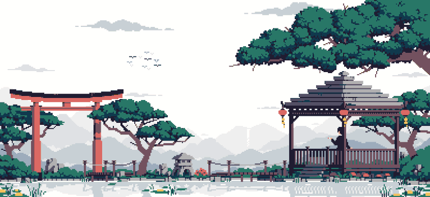

  

<!-- upstream:start -->
### Contributed to

<a href="https://github.com/haritel97"> @haritel97</a>&nbsp;&nbsp;&nbsp;&nbsp;<a href="https://github.com/purahan"> @purahan</a>&nbsp;&nbsp;&nbsp;&nbsp;<a href="https://github.com/NateTheGrappler"> @NateTheGrappler</a>

<a href="https://github.com/unstablebuild"> @unstablebuild</a>&nbsp;&nbsp;&nbsp;&nbsp;<a href="https://github.com/kubernetes-sigs"> @kubernetes-sigs</a>&nbsp;&nbsp;&nbsp;&nbsp;<a href="https://github.com/wized2"> @wized2</a>

<a href="https://github.com/zenos-org"> @zenos-org</a>&nbsp;&nbsp;&nbsp;&nbsp;<a href="https://github.com/branben"> @branben</a>&nbsp;&nbsp;&nbsp;&nbsp;<a href="https://github.com/european-summer-of-code"> @european-summer-of-code</a>

<a href="https://github.com/glotzerlab"> @glotzerlab</a>&nbsp;&nbsp;&nbsp;&nbsp;<a href="https://github.com/OWASP"> @OWASP</a>&nbsp;&nbsp;&nbsp;&nbsp;<a href="https://github.com/Pranayd555"> @Pranayd555</a>

<a href="https://github.com/sirraya-labs"> @sirraya-labs</a>&nbsp;&nbsp;&nbsp;&nbsp;<a href="https://github.com/TabularisDB"> @TabularisDB</a>

<!-- upstream:end -->

  

Both banners are fan-made pixel art, not my own work. Pokémon © Nintendo / Game Freak. The original artists aren't credited here.

